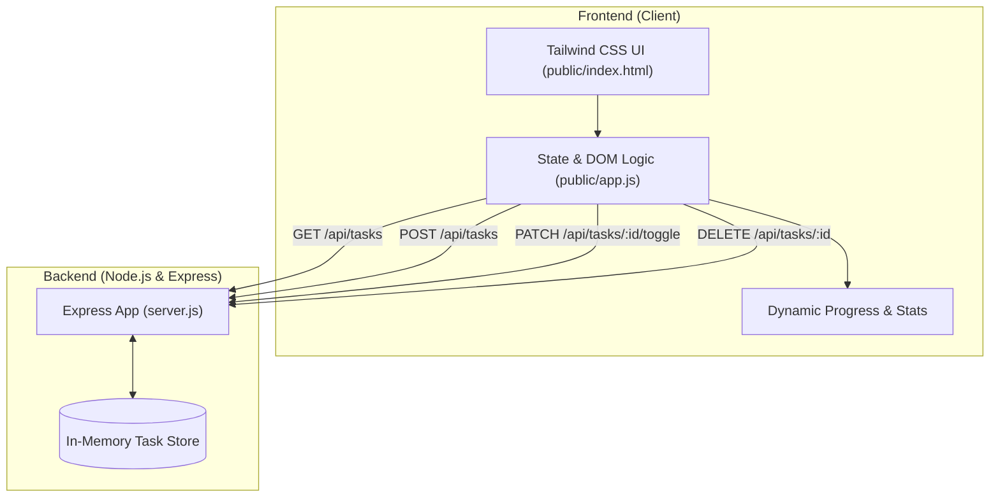

# FlowTrack ⚡ - Full-Stack Habit & Task Tracker

FlowTrack is a modern, lightweight full-stack web application designed to help you track daily habits, manage tasks, and maintain consistency. Built with **Node.js**, **Express**, **Tailwind CSS**, and **vanilla JavaScript**, it features a sleek dark-mode user interface, a live dynamic progress bar, interactive category filters, a robust REST API, and production-ready Docker containerization.

---

## 🌟 Features

- **Dynamic Progress Bar**: Live completion percentage calculation with smooth animated transitions and real-time motivational microcopy.
- **Categorized Tracking**: Distinguish between recurring **Habits (🌱)** and one-off **Tasks (📋)**.
- **Smart Filtering**: Seamlessly filter items by **All**, **Active**, **Done**, **Habits**, or **Tasks** with active count badges.
- **Sleek Dark Mode UI**: Modern slate/zinc palette powered by Tailwind CSS CDN, ambient backdrop glow effects, and interactive feedback toasts.
- **In-Memory REST API**: Fast, zero-configuration backend data store with full CRUD capabilities.
- **Automated Testing Suite**: Built-in test coverage using Node.js's native test runner (`node:test` & `node:assert`).
- **Containerized**: Production-grade `Dockerfile` with multi-stage caching, non-root security (`node:20-alpine`), and `docker-compose.yml` support.

---

## 🛠️ Tech Stack

| Layer | Technology |
|---|---|
| **Frontend** | HTML5, Tailwind CSS (CDN), Vanilla JavaScript |
| **Backend** | Node.js (v20+), Express.js |
| **Data Storage** | In-Memory Data Store |
| **Testing** | Node.js Native Test Runner (`node:test`) |
| **Containerization** | Docker, Docker Compose |

---

## 🏗️ Architecture



---

## 📁 Project Structure

```text
my-first-antigravity-app/
├── public/
│   ├── index.html       # Single-page UI with Tailwind CSS & dark mode styling
│   └── app.js           # Client-side state management, fetch calls & DOM rendering
├── test/
│   └── api.test.js      # Automated endpoint and validation tests (node:test)
├── .dockerignore        # Docker build context exclusion rules
├── .gitignore           # Git ignore file for dependencies, logs, and environments
├── docker-compose.yml   # Multi-container / single-service orchestration file
├── Dockerfile           # Optimized production container definition (node:20-alpine)
├── package.json         # NPM project manifest, dependencies & scripts
├── package-lock.json    # Exact dependency tree lockfile
├── README.md            # Project documentation and guides
└── server.js            # Express application entry point & REST API routes
```

---

## 🚀 Getting Started

### Prerequisites

Ensure you have the following installed on your machine:
- [Node.js](https://nodejs.org/) (v20.0.0 or higher recommended)
- [npm](https://www.npmjs.com/) (bundled with Node.js)
- *(Optional)* [Docker Desktop](https://www.docker.com/products/docker-desktop/)

---

### Local Installation & Setup

1. **Clone or navigate to the repository:**
   ```bash
   cd my-first-antigravity-app
   ```

2. **Install project dependencies:**
   ```bash
   npm install
   ```

3. **Start the development/production server:**
   ```bash
   npm start
   ```

4. **Open in browser:**
   Navigate to [http://localhost:3000](http://localhost:3000).

---

## 🐳 Running with Docker

### Using Docker CLI

1. **Build the Docker image:**
   ```bash
   docker build -t habit-task-tracker .
   ```

2. **Run the container:**
   ```bash
   docker run -d -p 3000:3000 --name flowtrack habit-task-tracker
   ```

3. **Stop the container:**
   ```bash
   docker stop flowtrack && docker rm flowtrack
   ```

### Using Docker Compose

1. **Start the application:**
   ```bash
   docker compose up -d
   ```

2. **View container logs:**
   ```bash
   docker compose logs -f
   ```

3. **Stop the container:**
   ```bash
   docker compose down
   ```

---

## 📡 REST API Reference

The server exposes standard RESTful endpoints under the `/api/tasks` namespace:

### 1. Retrieve all tasks
- **URL**: `GET /api/tasks`
- **Response**: `200 OK`
- **Example Response**:
  ```json
  [
    {
      "id": "1",
      "title": "Morning meditation (10 mins)",
      "completed": true,
      "category": "habit",
      "createdAt": "2026-10-06T10:29:44.823Z"
    },
    {
      "id": "2",
      "title": "Drink 2L water throughout the day",
      "completed": false,
      "category": "habit",
      "createdAt": "2026-10-06T10:29:44.831Z"
    }
  ]
  ```

---

### 2. Create a new task or habit
- **URL**: `POST /api/tasks`
- **Headers**: `Content-Type: application/json`
- **Request Body**:
  ```json
  {
    "title": "Read 15 pages",
    "category": "habit"
  }
  ```
  *(Note: `category` can be `"habit"` or `"task"`. Defaults to `"task"` if omitted).*
- **Response**: `201 Created`
- **Validation**: Returns `400 Bad Request` if `title` is missing or empty.

---

### 3. Toggle task completion
- **URL**: `PATCH /api/tasks/:id/toggle`
- **Response**: `200 OK`
- **Example Response**:
  ```json
  {
    "id": "2",
    "title": "Drink 2L water throughout the day",
    "completed": true,
    "category": "habit",
    "createdAt": "2026-10-06T10:29:44.831Z"
  }
  ```
- **Error**: Returns `404 Not Found` if the task does not exist.

---

### 4. Delete a task
- **URL**: `DELETE /api/tasks/:id`
- **Response**: `200 OK`
- **Example Response**:
  ```json
  {
    "message": "Task deleted successfully",
    "task": {
      "id": "2",
      "title": "Drink 2L water throughout the day"
    }
  }
  ```
- **Error**: Returns `404 Not Found` if the task does not exist.

---

## 🧪 Running Automated Tests

The test suite runs with Node's built-in test runner (`node:test`) without requiring external testing frameworks:

```bash
npm test
```

### Test Coverage Highlights:
- ✅ `GET /api/tasks` returns initial seeded tasks.
- ✅ `POST /api/tasks` creates new tasks with generated IDs and timestamps.
- ✅ `POST /api/tasks` rejects empty titles with `400 Bad Request`.
- ✅ `PATCH /api/tasks/:id/toggle` flips status between `false` and `true`.
- ✅ `PATCH /api/tasks/:id/toggle` returns `404` for non-existent IDs.
- ✅ `DELETE /api/tasks/:id` successfully removes tasks.
- ✅ `DELETE /api/tasks/:id` returns `404` for non-existent IDs.

---

## ⚙️ Environment Variables

| Variable | Description | Default |
|---|---|---|
| `PORT` | The port the HTTP server listens on | `3000` |
| `NODE_ENV` | Application environment mode (`development` / `production`) | `production` (in Docker) |

---

## 📄 License

This project is open-source and available under the [ISC License](file:///f:/my-first-antigravity-app/package.json).
